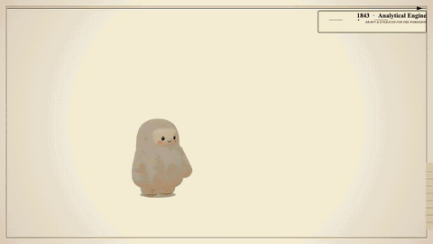

# A Short History of Computing

**[▶ Step inside the film](https://sophiamyang.github.io/muse-computer-history/)**: explore each era in your browser, click the machines and travel through time.



*The 61-second film as a GIF (no sound). Watch it in full quality with music: [`media/film.mp4`](media/film.mp4).*

Jolly, a small plush explorer, travels through about 180 years of computing. In each era she does one small thing with
that era's machine. She turns a crank, plugs in a cable, feeds in a punched card, then travels on *through an object*
in the scene: into a screen, a slot or a lens, where the next era is already waiting. Every era is drawn in the style
of its own time, from a Victorian engraving to 8-bit pixel art.

The scenes and the music were created by **[Muse Spark](https://fireworks.ai)**, running on Fireworks. It wrote the
code that draws and animates every era, and composed the score, using the
[portal-film](https://github.com/sophiamyang/portal-film) skill.

## The journey

| | Era | Style | What Jolly does | How she travels on |
|---|---|---|---|---|
| 1 | 1843 · Analytical Engine | Copperplate engraving | Turns the brass crank: the gears mesh, a punched card advances, a bell rings | Into the Engine's figure wheels |
| 2 | 1946 · Electronic computer | Black-and-white newsreel | Plugs in a patch cable: a vacuum tube flares, the lamps light up row by row | Into the glowing tube |
| 3 | 1969 · Mainframes | Mid-century cut paper | Feeds a punched card into the reader: the tape reels spin, the teletype prints | Through the card slot |
| 4 | 1983 · Home computers | 8-bit pixel art | Bumps the floppy drive: a disk pops out and the counter ticks up | Into the screen |
| 5 | 1996 · The web | A 90s personal home page | Presses Connect, the modem dials, she hops over ENTER | Pulls back: the page was on a phone |
| 6 | 2007 · Smartphones | Glossy white showroom | Slides a glass pane aside: the spotlights snap on, a tablet wakes | Into the tablet |
| 7 | 2017 · Attention | Whiteboard and marker | Fills in "the cat napped because ___ was tired" with "it": attention arcs reach every word, the strongest to "cat" | Into the circle around "it" |
| 8 | 2026 · GPU clusters | Isometric datacenter | Pulls the TOKENS lever: light sweeps the racks and she rides the token belt | Pulls back: it was on a laptop |
| 9 | Now · Muse Spark on Fireworks | Warm dusk room | Asks the laptop "light up the sky?", closes the lid, and fireworks fill the city sky | — |

The music is a single warm theme that passes from instrument to instrument: a music box, a muted trumpet, a
vibraphone, a chiptune lead, a nylon guitar, a marimba, a piano and a synth pad, then a full ensemble for the
fireworks.

## Explore it yourself

The same film is also a website you can step inside: **[https://sophiamyang.github.io/muse-computer-history/](https://sophiamyang.github.io/muse-computer-history/)**. Jolly waits in each era. Click the
machine to make her act, then click the object to travel to the next era. Hidden notes in each scene tell you a little
more about that moment in computing.

To run it locally:

```sh
python3 -m http.server 8000
```

Then open http://localhost:8000/site.html. It's a static folder, so GitHub Pages or any web host can serve it.

## What's in this repo

```
├── index.html, site.html      the website (index.html opens site.html; index.html?mode=film is a film player)
├── pages.html                 a page-by-page version
├── film.js                    the order of the scenes and the website settings
├── scenes/                    the nine scenes, written by Muse Spark
├── character3d.mjs            Jolly, the 3D character
├── runtime/                   the portal-film engine
├── media/                     film.mp4, film.gif, score.wav (the music), poses.png (Jolly's poses)
├── muse-spark/                story.md (the plan), prompts/ (briefs given to Muse Spark),
│                              transcripts/ (its responses), notes/ (revision notes)
├── build/                     timeline (plan.json), music notes (score.json), quality report (gate.md)
└── tools/                     scripts to call Muse Spark, build the music and check the film
```

## Rebuilding the film

You need Node 18+, Python 3, the [portal-film](https://github.com/sophiamyang/portal-film) skill, and a Fireworks
API key (`FIREWORKS_API_KEY`) to call Muse Spark.

```sh
# one-time setup of the local tools (ffmpeg, a headless browser, the SoundFont)
mkdir -p .tools/sf && cd .tools && echo '{"private":true}' > package.json
npm i ffmpeg-static ffprobe-static @napi-rs/canvas spessasynth_core && mkdir -p bin
ln -sf "$(node -p "require('ffmpeg-static')")" bin/ffmpeg && ln -sf "$(node -p "require('ffprobe-static').path")" bin/ffprobe
python3 -m venv venv && venv/bin/pip install numpy scipy pillow matplotlib playwright && venv/bin/python -m playwright install chromium
curl -L -o sf/GeneralUser-GS.sf2 https://raw.githubusercontent.com/mrbumpy409/GeneralUser-GS/main/GeneralUser-GS.sf2
cd .. && ln -sfn .tools/node_modules node_modules

# build: timeline, music, video, quality check
export NODE_PATH=.tools/node_modules PATH=.tools/bin:$PATH
SK=path/to/portal-film/portal-film
node $SK/scripts/render.cjs . --plan build/plan.json
sh tools/make_score.sh
.tools/venv/bin/python $SK/scripts/render_browser.py . --out media/film.mp4 --audio media/score.wav
.tools/venv/bin/python $SK/scripts/gate.py build/plan.json media/film.mp4 --audio media/score.wav --report build/gate.md

# ask Muse Spark to revise a scene or the music
node tools/muse.mjs <scene> --fix --note "what to change"
node tools/muse_compose.mjs compose --fix --note "what to change"
```
